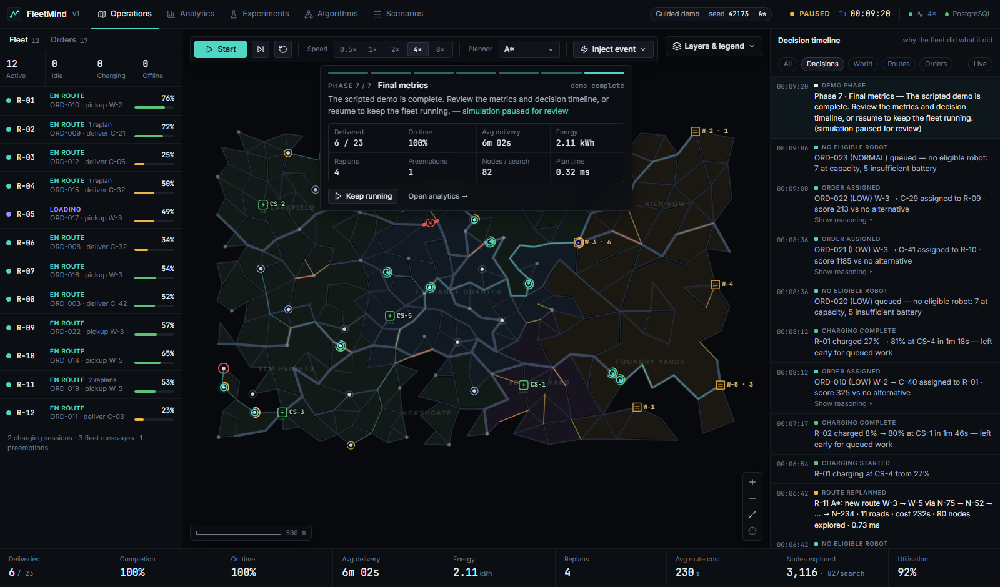
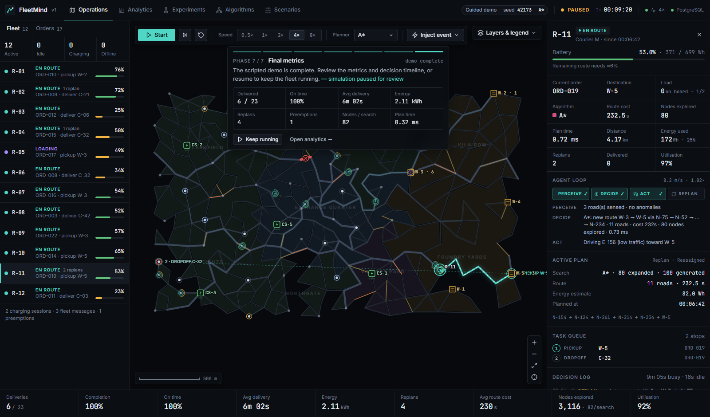
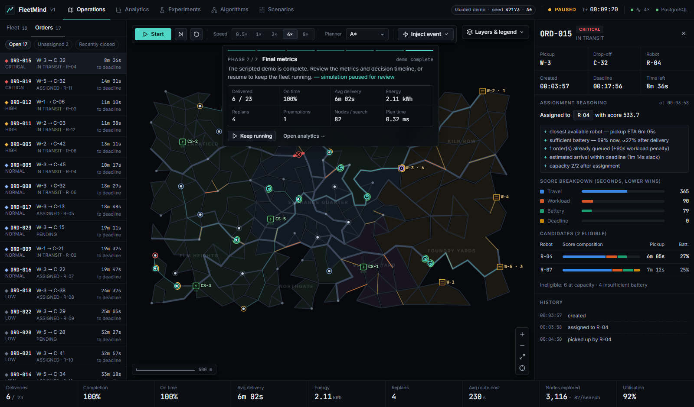
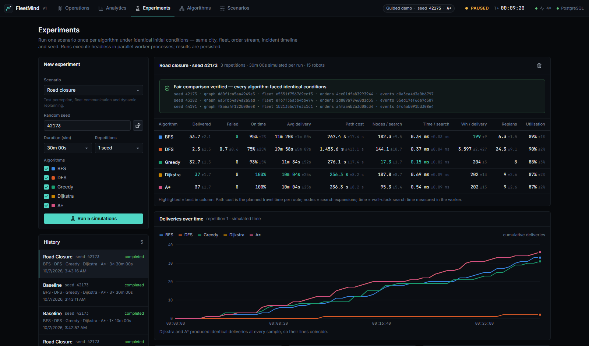
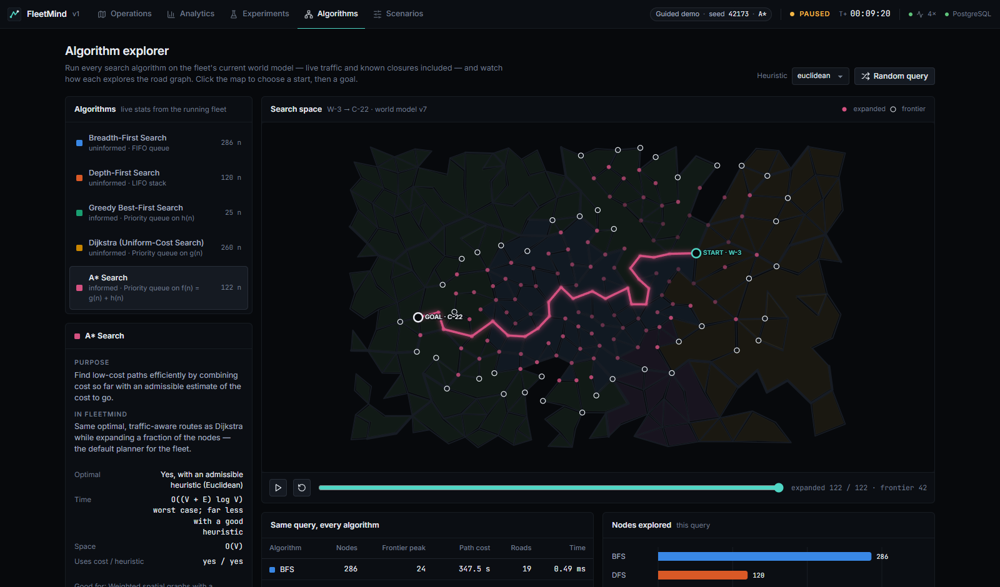

# FleetMind

**An autonomous multi-agent delivery planning and simulation platform.**

FleetMind simulates a logistics district in which a fleet of autonomous delivery robots receives
delivery requests, competes for them through an explainable task allocator, plans routes with
classical search algorithms, perceives a changing world, coordinates over a shared channel and
replans when roads close, traffic builds or batteries run low. The same deterministic engine is
also an experimental laboratory: run one scenario under BFS, DFS, Greedy Best-First, Dijkstra
and A* with identical initial conditions and compare the results.



The console answers three questions:

| Question | Where |
|---|---|
| **What is happening?** | Live map of robots, routes, traffic, closures, chargers and orders; fleet and order lists; KPI strip |
| **Why is it happening?** | Decision timeline, robot inspector (PERCEIVE → DECIDE → ACT → REPLAN), assignment reasoning with a score breakdown per candidate, old vs. new routes on replanning |
| **How well did it work?** | Analytics, controlled algorithm experiments with fairness verification, algorithm explorer |

---

## Contents

- [Quick start](#quick-start)
- [What you will see](#what-you-will-see)
- [Architecture](#architecture)
- [AI in FleetMind](#ai-in-fleetmind)
- [Mapping to an AI curriculum](#mapping-to-an-ai-curriculum)
- [Experiment & benchmark methodology](#experiment--benchmark-methodology)
- [Results](#results-measured)
- [Usage reference](#usage-reference)
- [Testing](#testing)
- [Limitations](#limitations)
- [Future work](#future-work)
- [Documentation](#documentation)

---

## Quick start

### Docker (recommended)

```bash
docker compose up --build
```

Open **http://localhost:8080**. This starts PostgreSQL 16, the FastAPI backend (migrations run
automatically) and the React console behind nginx. The API is also exposed on
http://localhost:8000 (`/docs` for the OpenAPI UI).

### Local development

Requirements: Python 3.11+, Node 20+, and PostgreSQL (or Docker for the database only).

```bash
# 1. Database
docker compose up -d db

# 2. Backend  (http://localhost:8000)
cd backend
python -m venv .venv
.venv/Scripts/activate          # Windows;  source .venv/bin/activate on macOS/Linux
pip install -r requirements-dev.txt
uvicorn app.main:app --reload --port 8000

# 3. Frontend (http://localhost:5173, proxies /api and /ws to :8000)
cd frontend
npm install
npm run dev
```

If PostgreSQL is not reachable the backend falls back to a local SQLite file and says so in
`/api/health` and in the console's top bar. Configuration lives in [`.env.example`](.env.example).

---

## What you will see

The app opens on the **Guided demo** scenario, paused, with 12 robots. Press **Start** (or
<kbd>Space</kbd>). The demo tells a seven-phase story, all of it produced by real agent behaviour —
the director only injects events at chosen moments:

| Phase | What happens |
|---|---|
| 1 · Normal delivery | Orders arrive; the allocator scores every robot and assigns the best; robots plan with A* |
| 2 · Traffic increase | A corridor ahead of an active robot jams; the traffic feed broadcasts it; affected robots re-evaluate |
| 3 · Road closure | An incident closes a road on a robot's route — *the fleet does not know yet* (dotted red marker) |
| 4 · Robot replanning | The robot perceives the closure from the adjacent junction, reports it, invalidates its route and replans |
| 5 · Battery warning | A battery fault drops a robot's charge; it checks feasibility and diverts to the best charger |
| 6 · High-priority order | A CRITICAL order arrives; the allocator may preempt a lower-priority pickup |
| 7 · Final metrics | The simulation pauses with a metrics summary |

At 1× (8 simulated seconds per second) the script takes about 70 seconds.

| Robot inspector | Assignment reasoning |
|---|---|
|  |  |

| Experiments | Algorithm explorer |
|---|---|
|  |  |

---

## Architecture

```mermaid
flowchart LR
  subgraph Browser["React console (Vite + TypeScript)"]
    Map["Canvas map renderer\n(60 fps, interpolated)"]
    Panels["Fleet · Orders · Timeline\nInspectors · KPIs"]
    Pages["Analytics · Experiments\nAlgorithms · Scenarios"]
  end

  subgraph API["FastAPI backend"]
    REST["REST commands\n/api/*"]
    WS["WebSocket stream\n/ws/simulation (15 Hz)"]
    Runtime["SimulationRuntime\nfixed-step pacing"]
    ExpSvc["ExperimentService\nprocess pool"]
  end

  subgraph Engine["Deterministic engine (pure Python)"]
    Env["Environment\n(ground truth graph)"]
    World["WorldModel\n(shared belief)"]
    Agents["RobotAgents\nperceive/decide/act"]
    Alloc["TaskAllocator"]
    Planners["BFS · DFS · Greedy\nDijkstra · A*"]
    Events["Event scheduler\n+ processor"]
    Metrics["MetricsCollector"]
  end

  DB[("PostgreSQL\nruns · events · metrics\nexperiments · results")]

  Map & Panels <-- snapshots --- WS
  Panels & Pages -- commands --> REST
  REST --> Runtime & ExpSvc
  Runtime --> Engine
  ExpSvc -- headless runs --> Engine
  Agents --> Planners --> World
  Events --> Env
  Agents -- perceive --> Env
  Agents -- report --> World
  Runtime & ExpSvc --> DB
```

* **One engine, two drivers.** The live runtime advances the engine in fixed ticks paced by the
  wall clock × speed; the experiment runner drives the identical engine headless as fast as
  possible in worker processes.
* **Determinism.** The engine never reads the wall clock. Every random draw comes from an
  independent seeded stream (city, fleet, orders, incidents, operator). Same scenario + seed +
  algorithm ⇒ the same run, verified by tests.
* **Truth vs. belief.** `Environment` is ground truth; `WorldModel` is the fleet's shared
  knowledge that planners search. Hidden closures make them diverge until an agent perceives
  the difference.
* **Patterns.** Strategy (planners behind `PathPlanner`), Observer (synchronous `EventBus`),
  Repository (persistence), dependency injection through FastAPI and the `AgentContext`.

Details: [docs/ARCHITECTURE.md](docs/ARCHITECTURE.md).

---

## AI in FleetMind

### The pipeline

```
delivery request → prioritisation (priority, deadline) → robot scoring & selection
→ route planning (selected algorithm) → execution (movement, energy drain)
→ perception (sensors at junctions) → fleet broadcast → replanning
→ delivery → metrics
```

### Intelligent agents

Every robot runs **PERCEIVE → DECIDE → ACT** each tick and **REPLAN** when its plan becomes invalid:

* **Perceive** – sense roads incident to the current/next junction; report closures the fleet
  does not yet know about.
* **Decide** – react to notifications (closure on route, congestion on route, CRITICAL insertion,
  reassignment), check battery feasibility, plan the next leg.
* **Act** – drive (time and energy depend on road class and *true* traffic), load, deliver,
  charge, queue at a charger.

### Search algorithms (`backend/app/planning/`)

Five independent implementations behind one interface; none calls another (enforced by a test).

| Algorithm | Frontier | Uses cost | Uses heuristic | Optimal here |
|---|---|---|---|---|
| BFS | FIFO queue | – | – | fewest roads, not least time |
| DFS | LIFO stack | – | – | no |
| Greedy Best-First | priority on h(n) | – | ✓ | no |
| Dijkstra | priority on g(n) | ✓ | – | yes |
| A* | priority on g(n)+h(n) | ✓ | ✓ | yes (admissible h) |

Edge cost is **travel time** (s) for a reference robot:
`length / (8 m/s × road-class factor) × traffic factor`, where arterials are faster (1.35×) and local streets slower (0.8×). The A* heuristic is
straight-line distance × the minimum possible cost per metre, which is **admissible and
consistent** on this irregular graph (proved empirically by tests over the whole city).
A Manhattan heuristic is available to demonstrate that it is *not* admissible on non-grid roads.
Every search reports path, cost, nodes expanded, nodes generated, peak frontier and time.
Full write-up: [docs/AI_ALGORITHMS.md](docs/AI_ALGORITHMS.md).

### Task allocation (`backend/app/allocation/`)

A transparent score in seconds — **lower wins**:

```
score = travel   (time until the robot can reach the pickup, incl. its queued work)
      + workload (90 s per order already queued)
      + battery  (6 s per % the robot would end below 40 %)
      + deadline (3 s per second of estimated lateness)
```

Robots that are offline, at capacity, recharging, or lack energy for the job plus a reserve to
reach a charger are ineligible, and the reason is recorded. Every assignment stores the winning
components, human-readable reasons, the runner-up, all candidates and the rejection summary —
shown in the order inspector. CRITICAL orders may **preempt** a robot still driving to a
LOW/NORMAL pickup when no free robot can make the deadline.

### Battery awareness

Energy = distance × robot rate × traffic factor. Robots refuse legs they cannot finish *plus*
reach a charger with a 6 % floor, re-check at every junction, choose chargers by travel time +
expected queue, verify the planned route to the charger is actually reachable (switching
stations if not), queue FIFO for slots, and leave charging early for queued work above 80 %.
A robot that does run dry stops and fails its parcel — nothing completes on credit.

### Multi-agent coordination

* Single-writer order book → an order can never be assigned twice.
* Shared world model as a blackboard; the first robot to see a closure updates it for everyone.
* Fleet channel broadcasts; only robots whose *remaining* route is affected replan.
* Charging-station reservations and queues; stations can become unavailable and robots reroute.

---

## Mapping to an AI curriculum

| Topic | Where it appears in FleetMind |
|---|---|
| **Intelligent agents** | `agents/robot.py` — PEAS: performance (deliveries, on-time, energy), environment (road graph), actuators (drive/load/charge), sensors (junction perception, traffic feed); explicit perceive–decide–act loop |
| **State-space representation** | Road network as a weighted graph; nodes = states, roads = actions, travel time = step cost; robot state machine |
| **Uninformed search: BFS, DFS** | `planning/bfs.py`, `planning/dfs.py` |
| **Best-first search** | `planning/greedy.py` (h only), `planning/dijkstra.py` (g only, uniform-cost) |
| **A* and heuristics** | `planning/astar.py`, `planning/heuristics.py`; admissibility/consistency tests; inadmissible Manhattan demonstration |
| **Planning & replanning** | Leg-by-leg planning on current knowledge; invalidation on closures, congestion re-evaluation, battery diversion |
| **Acting under incomplete information** | Truth vs. belief (`Environment` vs. `WorldModel`); hidden closures discovered by perception |
| **Uncertainty / Bayesian extension** | *Not implemented.* The world model is the natural place for a probabilistic traffic belief — see [Future work](#future-work) |
| **Multi-agent planning** | Market-like task allocation with explainable scores, preemption, shared blackboard, resource (charger) coordination |
| **Experimental evaluation** | Controlled, seeded, fingerprint-verified algorithm comparisons with repetitions |

---

## Experiment & benchmark methodology

1. Choose a scenario, a base seed, a duration and a number of repetitions *r*.
2. For each repetition the seed is `base + r × 1009`. Within a repetition every algorithm runs
   from the **same seed**: same city, same fleet (positions, models, batteries), same order
   arrival stream, same pre-generated incident timeline.
3. The engine fingerprints the graph, fleet, order-stream RNG state and incident schedule. The
   runner checks that the fingerprints are identical across algorithms and reports the
   verification with the results (*Fair comparison verified*).
4. Each run executes headless in a separate worker process; metrics come from the run's own
   metrics collector. Means and standard deviations are taken across repetitions.
5. Results are stored in PostgreSQL (`experiments`, `algorithm_results`, `simulation_runs`).

Notes on fairness: scenario incidents depend only on the seed, never on agent behaviour, so
every algorithm faces the same closures at the same times. The guided demo's director *does*
target agents and is therefore excluded from experiments. Planning time is wall-clock time and
varies slightly with machine load; node counts and costs are exact.

More: [docs/EXPERIMENTS.md](docs/EXPERIMENTS.md).

---

## Results (measured)

Measured with the Docker stack, base seed **42173**, **3 repetitions × 30 simulated minutes**,
15 robots. Reproduce from the Experiments page or `POST /api/experiments/run`. Means across the
three seeds.

**Baseline**

| Algorithm | Delivered | Avg delivery | Path cost (s) | Nodes / search | Time / search | Wh / delivery | Robots stranded |
|---|---:|---:|---:|---:|---:|---:|---:|
| BFS | 34.7 | 11m 11s | 263.4 | 182.4 | 0.30 ms | 195 | 0 |
| DFS | 3.7 | 22m 42s | 1407.3 | 144.3 | 0.34 ms | 2952 | 1.3 |
| Greedy | 34.3 | 11m 03s | 265.9 | **16.9** | **0.11 ms** | 199 | 0 |
| Dijkstra | **38.3** | **10m 03s** | **230.7** | 184.6 | 0.53 ms | 199 | 0 |
| A* | **38.3** | **10m 03s** | **230.7** | 89.9 | 0.41 ms | 199 | 0 |

**Road closure** (9 scheduled closures + random failures)

| Algorithm | Delivered | Avg delivery | Path cost (s) | Nodes / search | Time / search | Replans |
|---|---:|---:|---:|---:|---:|---:|
| BFS | 33.7 | 11m 20s | 267.4 | 182.3 | 0.34 ms | 6.3 |
| DFS | 2.3 | 19m 58s | 1453.6 | 144.1 | 0.37 ms | 24.3 |
| Greedy | 32.7 | 11m 34s | 276.1 | **17.3** | **0.15 ms** | 8.0 |
| Dijkstra | **37.0** | **10m 04s** | **236.3** | 187.8 | 0.69 ms | 9.0 |
| A* | **37.0** | **10m 04s** | **236.3** | 95.3 | 0.54 ms | 9.0 |

What the numbers show: A* reproduces Dijkstra's optimal routes — and therefore identical fleet
outcomes — while expanding about half as many nodes. Greedy is the cheapest search by far but its
routes cost ~15–17 % more travel time, which costs deliveries. BFS ignores travel time and road
speed. DFS's winding routes cost ~6× more travel time and 15–18× more energy per delivery; robots
run out of battery and the fleet collapses. (Absolute times are per search on a ~340-node graph
in CPython; the relative ordering is what matters.)

---

## Usage reference

**Keyboard (Operations):** <kbd>Space</kbd> start/pause · <kbd>S</kbd> step 2 s · <kbd>1</kbd>–<kbd>5</kbd> speed
0.5×–8× · <kbd>Shift</kbd>+<kbd>R</kbd> reset · <kbd>[</kbd> <kbd>]</kbd> previous/next robot · <kbd>F</kbd> fit map ·
<kbd>C</kbd> follow/centre selection · <kbd>Esc</kbd> cancel tool / clear selection.

**Map:** drag to pan, wheel to zoom, click a robot / warehouse / charger / customer / road to
inspect it. *Inject event* offers road closure (pick a road or auto-target an active route),
congestion, CRITICAL order, battery fault, robot failure and charger outage. Every button calls
the real API.

**Scenarios:** Guided demo, Baseline, Congestion, Road closure, Battery critical, Surge — plus a
builder for robots, orders, arrival rate, priority mix, traffic, closures, failure probability,
battery ranges, algorithm, heuristic, seed, speed and duration.

**API:** see [docs/API.md](docs/API.md) or the live OpenAPI UI at `http://localhost:8000/docs`.

---

## Testing

```bash
cd backend && pytest            # 70 tests: unit + integration (engine, API, WebSocket, experiments)
cd frontend && npm run typecheck
```

Covered: every planner (validity, optimality, failure, traces, module independence), heuristic
admissibility/consistency (and Manhattan's inadmissibility), graph generation (determinism,
connectivity, planarity, Euler's formula), energy model, charging, depletion, allocation
(explanations, eligibility, capacity, no double assignment, priority order, preemption),
replanning (operator and hidden closures, fleet broadcast, congestion re-evaluation, battery
diversion), determinism, full delivery lifecycle, experiment fairness, and the HTTP/WebSocket API.

---

## Limitations

* The city is procedurally generated, not a real map; roads are undirected straight segments
  and there are no intersections with signal timing.
* Robots do not physically collide or reserve road capacity; congestion is an environment
  property, not caused by the fleet itself.
* Allocation uses straight-line ETA estimates (deliberately independent of the planner under
  test); capacity means concurrent assigned orders, executed sequentially (no batching/TSP).
* Traffic is known immediately through a feed; only closures need to be perceived.
* Planning time is measured in CPython and is useful for *relative* comparison only.
* Live-run persistence buffers events and flushes every two seconds; a hard crash can lose the
  last batch.

## Future work

The engine is structured so these can be added without rewriting it:

* **Allocation strategies** — genetic algorithms or hill climbing behind the allocator interface;
  auction-based (contract-net) allocation.
* **Bayesian traffic prediction** — a probabilistic belief in `WorldModel` updated from robot
  observations, with risk-aware edge costs.
* **Reinforcement learning** — learned dispatch or charging policies trained on the headless engine.
* **Hierarchical planning** — district-level abstraction graphs for large maps; time-dependent
  costs; multi-agent path finding (CBS) to prevent conflicts.
* **Real maps & co-simulation** — OpenStreetMap import into `Environment`; SUMO for traffic.
* **Real robots** — a ROS 2 bridge where `RobotAgent` actions become navigation goals; drone agents
  with a different movement model.

## Documentation

| | |
|---|---|
| [docs/ARCHITECTURE.md](docs/ARCHITECTURE.md) | Components, data flow, design decisions, persistence |
| [docs/AI_ALGORITHMS.md](docs/AI_ALGORITHMS.md) | Each algorithm: what, why, complexity, behaviour in FleetMind; heuristics; allocation |
| [docs/SIMULATION.md](docs/SIMULATION.md) | World model, movement & energy, agent state machine, events, scenarios, demo |
| [docs/EXPERIMENTS.md](docs/EXPERIMENTS.md) | Experimental design, metrics definitions, reproduction |
| [docs/API.md](docs/API.md) | REST endpoints and the WebSocket protocol |
| [docs/CONTRIBUTING.md](docs/CONTRIBUTING.md) | Development workflow, adding an algorithm or scenario |
